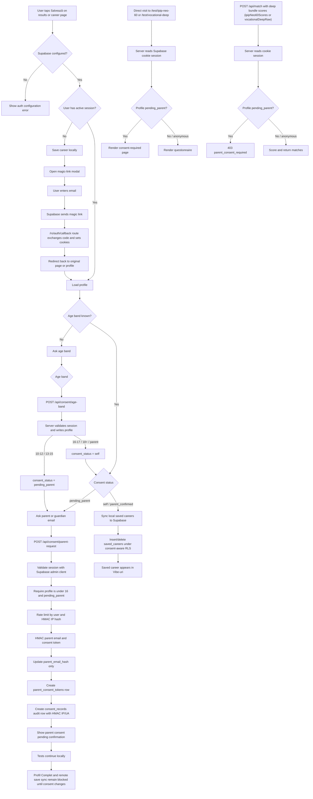

# Auth and Minor Consent Flow

This documents the Supabase auth + parent-consent slice for CeSaFiu.

Scope in this version:

- `Salvează` is the first auth gate.
- Magic-link auth creates/loads the user session through a cookie-backed Supabase callback.
- The app asks for an age band after auth.
- Users aged `10-12` or `13-15` enter `pending_parent`.
- Age-band and consent-state writes are server-side only.
- Parent email is HMAC-hashed and a hashed consent request token is recorded.
- `saved_careers` inserts are consent-aware in RLS.
- **Profil Complet** (IPIP-NEO-60 + Vocațional Complet + PDF report) is free during the pilot, but structured as a future paid bundle. It is server-gated for `pending_parent` users at both the page level (`/test/[slug]` for any slug in `PAID_TEST_SLUGS`) and the API level (`/api/match` when the body carries any `PAID_MATCH_FIELDS`).
- See [PAID-BUNDLE-POSITIONING.md](./PAID-BUNDLE-POSITIONING.md) for the bundle product decision and copy.
- Parent emails are sent through **Brevo** (`apps/web/src/lib/email/brevo.ts`) using a branded RO template (`apps/web/src/lib/email/templates/parent-consent.ts`). On Brevo failure the token row is rolled back and an audit row with `event = 'parent_consent_email_failed'` is written so the user can retry cleanly within rate limits.
- Parent confirmation is handled by `GET /api/consent/parent-confirm?token=…`, which HMACs the supplied token, constant-time compares against the stored hash, gates the `used_at` update with a `WHERE used_at IS NULL` race guard, flips `consent_status` to `parent_confirmed`, audits with `event = 'parent_consent_confirmed'`, and `303`-redirects to `/[locale]/acord-parinte?status=…` so the token never lingers in browser history.

## Flowchart

## Data Model

`profiles`

- One row per Supabase auth user.
- Stores `age_band`, `consent_status`, optional display name, and a hashed parent email for minor consent.
- Authenticated users can read only their own row.
- Client insert/update grants are revoked; profile consent fields are written through server API routes.

`saved_careers`

- Stores `(user_id, career_id)`.
- Protected by RLS so authenticated users can select and delete only their own saved careers.
- Inserts additionally require the user's profile to have `consent_status in ('self', 'parent_confirmed')`.
- Does not foreign-key `career_id` yet because careers are still file-backed in the app.

`parent_consent_tokens`

- Stores HMAC hashes of generated parent-consent tokens for future email confirmation.
- RLS is enabled with no browser policies; only server-side privileged access should use it.

`consent_records`

- Audit table for consent-related events.
- Current event: `parent_consent_requested`.
- Stores HMAC hashes of request IP and user agent for abuse investigation without retaining raw values.
- Authenticated users can only read their own consent records.

## Current Limitations

- Session replay masking still needs verification in a real Umami recording.
- The secret key must be configured only as an environment variable.
- `CONSENT_HASH_PEPPER` must be configured as a server-only environment variable.
- The secret key that was shared during implementation should be rotated before production.
- `BREVO_API_KEY`, `EMAIL_FROM_ADDRESS` and `EMAIL_FROM_NAME` must be configured server-only. Without them, `parent-request` returns `502 email_send_failed` and rolls back the token.
- Auth Email Templates (Confirm signup / Magic Link / Invite / Change Email / Reset / Reauthentication) are single-language in Supabase. RO templates live in `docs/email-templates/` and must be pasted into the Supabase dashboard. Multi-locale would require routing through the **Send Email Hook**.

## Account sync + header account chip (2026-11-02)

- **What syncs:** saved careers, saved path (existing) + **test results** (`test_results`, latest per instrument, newest `completedAt` wins) + **saved universities** (`saved_universities`, union merge). Migrations: `supabase/migrations/20261102092053_account_sync.sql` and `20261102092143_account_sync_rls_hardening.sql`.
- **Consent gate:** pushes only when `age_band <> 'unknown'` and `consent_status in ('self','parent_confirmed')` — enforced client-side and by RLS (`can_persist_account_data()`). Pending-consent students stay local-only.
- **When:** full merge on sign-in and right after the age step; live push on test completion (`cesafiu:test-saved` window event) and on university toggles (uni-store subscription).
- **Sign-out:** a final remote flush is verified before local results/saves are wiped from the device (shared school computers). If that flush fails or consent is pending, local data is kept (it may be the only copy).
- **UI:** `components/auth/account-chip.tsx` in page headers (signed out → "Intră în cont"; signed in → email initial + status dot + menu with email, sync status, sign-out). `/profil` identity card shows "Contul tău" + email, or "Profil local" + account invite after ≥1 test. `/rezultate` save card copy is account-aware, with a small secondary link when saved locally without an account.

## Brevo heartbeat

- `POST /api/cron/brevo-heartbeat` (Bearer `CRON_SECRET`) sends a weekly status email through the Brevo REST API → keeps `BREVO_API_KEY` in use. Triggered by `.github/workflows/brevo-heartbeat.yml` (Mondays). A failed send returns 502 → the workflow fails → GitHub emails you.
- Env (Railway): `CRON_SECRET` (≥16 chars), optional `HEARTBEAT_EMAIL_TO`. GitHub repo secret: `CRON_SECRET` (same value).
- Note: magic-link emails go through Supabase SMTP with a Brevo **SMTP key**, which is separate from the API key. Every sign-in uses the SMTP key; the heartbeat covers the API key.
